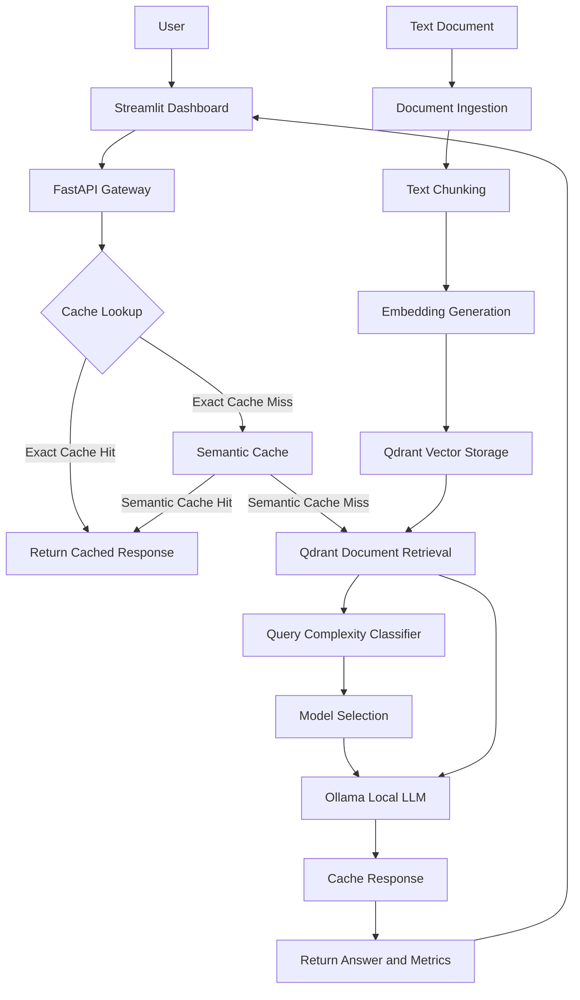

# Cost-Aware RAG Gateway

A local-first, cost-aware Retrieval-Augmented Generation (RAG) system that combines document retrieval, semantic caching, and ML-powered LLM routing to improve the efficiency of document-grounded question answering.

## Overview

Large Language Model (LLM) applications can incur unnecessary inference costs when every request is processed by the same model, even when many questions are simple or repeated.

**Cost-Aware RAG Gateway** addresses this challenge by combining retrieval, caching, and model selection in a single application. Users can upload text documents, ask questions about their contents, and inspect request-level performance and routing metrics through an interactive dashboard.

The system runs language models locally through Ollama, while Qdrant provides vector storage and Valkey supports exact-response caching.

## Key Features

- **Document ingestion:** Upload `.txt` documents through the Streamlit dashboard.
- **Retrieval-Augmented Generation:** Chunk documents, generate embeddings, retrieve relevant passages, and use them as context for answer generation.
- **Semantic caching:** Reuse responses for sufficiently similar questions using embedding-based similarity search.
- **Exact-response caching:** Cache responses to repeated queries.
- **ML-powered model routing:** Use a pretrained Hugging Face query-complexity classifier to select an appropriate local language model.
- **Local inference:** Run selected LLMs through Ollama instead of relying on a hosted LLM API for generation.
- **Performance observability:** Inspect retrieval, routing, generation, cache lookup, and end-to-end latency.
- **Source visibility:** Display retrieved document sources and chunk-level retrieval information.
- **Interactive interface:** Use a Streamlit dashboard backed by a FastAPI service.

## Architecture



The ingestion pipeline prepares documents for retrieval. During a question-answering request, the gateway checks its caches, retrieves relevant document context when needed, selects a model, and generates a grounded response. The dashboard displays the answer and available request metrics.

## Technology Stack

| Component | Technology | Purpose |
|---|---|---|
| API backend | FastAPI | Request handling and API endpoints |
| User interface | Streamlit | Chat, document upload, and metrics |
| Vector database | Qdrant | Document embeddings and semantic search |
| Exact cache | Valkey | Repeated-response caching |
| Embedding model | `sentence-transformers/all-MiniLM-L6-v2` | Document and retrieval embeddings |
| Semantic cache embeddings | `BAAI/bge-small-en-v1.5` | Semantic similarity matching |
| Query classification | Hugging Face Transformers | Query-complexity classification |
| Local inference | Ollama | LLM inference |
| Simple model | `qwen2.5:3b` | Local response generation |
| Complex model | `llama3.2:3b` | Local response generation |

## How It Works

### 1. Document Ingestion

1. A user uploads a UTF-8 `.txt` document through Streamlit.
2. The FastAPI ingestion endpoint receives the document.
3. The text is divided into chunks using a recursive character text splitter, configured with a chunk size of 300 and an overlap of 50.
4. The embedding model converts the chunks into normalized 384-dimensional vectors.
5. Qdrant stores the vectors alongside document text and metadata.

### 2. Retrieval-Augmented Generation

When a user submits a question, the system retrieves relevant document chunks using vector similarity search. The retrieved context is supplied to the selected language model to generate a document-grounded response.

The generation instructions direct the model to use the supplied context and acknowledge when the required information is unavailable.

### 3. Exact and Semantic Caching

The gateway supports two caching mechanisms:

- **Exact caching:** Looks for a previously cached response to the same query.
- **Semantic caching:** Uses embedding similarity to identify potentially reusable responses to differently worded questions.

The semantic cache uses a configurable similarity threshold, currently set to `0.80`, alongside conflicting-intent checks to reduce unsafe response reuse.

### 4. Model Routing

A pretrained query-complexity classifier predicts the complexity category of an incoming question. The routing layer maps the predicted category to one of the configured Ollama models.

- `qwen2.5:3b` handles the configured simpler-query categories.
- `llama3.2:3b` handles the configured complex-query category.

This design aims to avoid using a larger model for every request. Actual cost savings and answer-quality improvements require evaluation against representative workloads.

### 5. Observability

The dashboard exposes request-level metrics, including:

- Total end-to-end latency
- Retrieval latency
- Model-routing latency
- Generation latency
- Exact and semantic cache lookup latency
- Selected model and predicted complexity
- Routing confidence
- Cache-hit status
- Retrieved source and chunk information

These metrics make it possible to inspect how different requests move through the gateway and evaluate future optimizations.

## Getting Started

### Prerequisites

Install or configure the following before running the project:

- Python 3.11 or another version compatible with the project's installed dependencies
- Ollama
- Valkey
- Git

Qdrant uses local persistent storage in this implementation.

### 1. Clone the Repository

```bash
git clone <your-repository-url>
cd cost-aware-rag
```

Replace `<your-repository-url>` with the actual Git repository URL.

### 2. Create and Activate a Virtual Environment

On Linux:

```bash
python -m venv .venv
source .venv/bin/activate
```

### 3. Install Dependencies

If the repository contains a `requirements.txt` file:

```bash
pip install -r requirements.txt
```

Otherwise, install the dependencies specified by the project and its dependency configuration.

### 4. Prepare the Local Models

Start Ollama and pull the configured generation models:

```bash
ollama pull qwen2.5:3b
ollama pull llama3.2:3b
```

The embedding models and pretrained classifier may require an initial download when the application starts.

### 5. Start Valkey

Ensure that a Valkey server is running and that the application's cache configuration points to it.

### 6. Start the FastAPI Backend

From the project root:

```bash
uvicorn app.main:app --reload
```

The API will normally be available at:

- API base URL: `http://127.0.0.1:8000`
- Interactive API documentation: `http://127.0.0.1:8000/docs`
- Health check: `http://127.0.0.1:8000/health`

### 7. Start the Streamlit Dashboard

Open another terminal, activate the same virtual environment, and run:

```bash
streamlit run streamlit_app.py
```

Open the local URL printed by Streamlit in your browser.

## API Endpoints

| Method | Endpoint | Description |
|---|---|---|
| `GET` | `/health` | Check whether the API is responding |
| `POST` | `/ingest` | Upload and ingest a `.txt` document |
| `POST` | `/ask` | Ask a question against the stored knowledge base |

Use the interactive Swagger documentation at `/docs` to inspect request schemas and test the endpoints.

## Example Usage

1. Start the backend services and open the Streamlit dashboard.
2. Upload a text document using the sidebar.
3. Ask a question whose answer is contained in the document.
4. Inspect the generated response and retrieved sources.
5. Ask a semantically similar question to observe whether the semantic cache can reuse a response.
6. Repeat an identical question to test exact-response caching.
7. Review the selected model, routing confidence, cache status, and latency metrics.

Cache hits depend on cache state, expiration, similarity thresholds, and safety checks; they are not guaranteed for every paraphrase.

## Current Scope and Limitations

- Document uploads currently support UTF-8 `.txt` files.
- Generation uses locally available Ollama models.
- Model routing depends on the classifier's predicted categories and the configured label-to-model mapping.
- Semantic caching can return an unsuitable answer if similarity and intent checks fail to distinguish different questions.
- Latency and cache-hit metrics are useful performance indicators, but do not independently establish monetary savings.
- The current implementation is intended as a local-first engineering project, not a production-hardened multi-user service.

## Future Improvements

- Support PDF and additional document formats.
- Add automated evaluation for retrieval quality, answer correctness, and routing decisions.
- Measure token usage and estimate inference cost across representative workloads.
- Add authentication, upload limits, and stronger operational safeguards.
- Improve cache invalidation and document lifecycle management.
- Add automated tests, structured logging, and deployment configuration.

---

**Cost-Aware RAG Gateway** explores how retrieval, semantic caching, and query-aware model selection can work together to build more efficient, observable LLM applications.